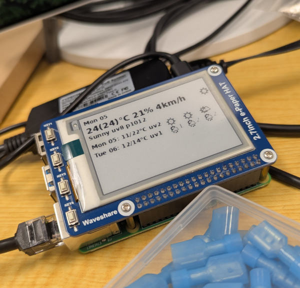

# Raspberry Pi Weather E-paper Screen



A small Python project that displays the current conditions and a two-day forecast on a Waveshare 2.7-inch four-level grayscale e-paper display connected to a Raspberry Pi Type B.

The screen is rendered by `ImageDrawer.WeatherScreen()` and transferred to the display by the Waveshare driver. Forecast data comes from the [wttr.in](https://wttr.in/) JSON API.

## Features

- Current temperature, “feels like” temperature, humidity, wind, pressure, UV index, and condition.
- Minimum/maximum temperatures and morning/noon/night summaries for today and tomorrow.
- Weather symbols based on wttr.in weather codes.
- Four-level grayscale rendering sized for the Waveshare display (`176 × 264` pixels).
- Utilities for drawing a weather screen, blanking the display, and showing a power-off message.

## Hardware

- Raspberry Pi Type B with SPI enabled
- Waveshare 2.7-inch e-paper display
- The Waveshare display driver and GPIO/SPI wiring expected by `resources/epdconfig.py`

The driver uses BCM GPIO numbering. The default pins are defined in `resources/epdconfig.py`:

| Signal      | BCM pin |
| ----------- | ------: |
| Reset       |      17 |
| DC          |      25 |
| Chip select |       8 |
| Busy        |      24 |
| Power       |      18 |

## Installation

Enable SPI with `raspi-config`, then install the dependencies on the Raspberry Pi:

```bash
python3 -m venv .venv
source .venv/bin/activate
pip install -r requirements.txt
```

`RPi.GPIO` and `spidev` are Raspberry Pi-specific packages, so the display programs need compatible hardware and drivers.

## Running it

Write today's and tomorrow's forecast on the screen:

```bash
python3 WeatherScreen.py
```

This fetches the forecast, creates a Pillow image, initializes the display in four-gray mode, writes the image, and puts the display to sleep. A local `config.yml` is created with metadata about the last query (timestamp and response MD5 hash).

Preview the generated image without writing to the e-paper display:

```bash
python3 ScreenDrawer.py
```

Other utilities:

```bash
python3 BlankDisplay.py
python3 PoweroffDisplay.py
```

## Project structure

| File                         | Responsibility                                                       |
| ---------------------------- | -------------------------------------------------------------------- |
| `Weather.py`                 | Fetches wttr.in JSON and maintains last-query metadata.              |
| `ScreenDrawer.py`            | Normalizes forecast values and draws the weather layout with Pillow. |
| `WeatherScreen.py`           | Connects the renderer to the e-paper hardware.                       |
| `BlankDisplay.py`            | Clears the display and puts it to sleep.                             |
| `PoweroffDisplay.py`         | Displays a shutdown banner before sleeping.                          |
| `resources/epd2in7.py`       | Waveshare 2.7-inch display driver.                                   |
| `resources/epdconfig.py`     | GPIO, SPI, power, and platform configuration.                        |
| `resources/wttrconstants.py` | Weather-code and weather-symbol mappings.                            |
| `resources/Fonts/`           | DejaVu Sans and Noto Emoji fonts used by the renderer.               |

## Reusable modules

### Weather data client

`Weather` can be used independently of the display:

```python
from Weather import Weather

weather = Weather("City or Region") # or a preconfigured identifier
data = weather.GetJsonData()
current = weather.GetCurrentWeather()
```

Extend `Weather.SetLocation()` to support another place, or replace it with a generic location/query implementation. `GetLastQueryMetadata()` is available to consumers that need request metadata.

### Image renderer

`ImageDrawer` is independent of the physical display. `WeatherScreen(place)` returns a Pillow drawing object and stores the complete grayscale image in `drawer.image`:

```python
from ScreenDrawer import ImageDrawer

drawer = ImageDrawer()
drawer.WeatherScreen("City or Region")
drawer.image.save("weather-preview.png")
```

The renderer can therefore be reused for previews, files, web dashboards, or other displays. Weather icons are supplied by `resources/wttrconstants.py`.

### Display adapter

The hardware-specific output is isolated in `WeatherScreen.py` and the `resources/` driver. The essential Waveshare-style interface is:

```python
epd = Screen.EPD()
epd.Init_4Gray()
epd.display_4Gray(epd.getbuffer_4Gray(drawer.image))
epd.sleep()
```

Replacing this adapter makes the weather client and image renderer reusable without a Raspberry Pi or attached e-paper panel.

## Configuration notes

- Set `USE_IS` in `ScreenDrawer.py` to select metric or imperial units; metric is the default.
- The renderer expects the bundled DejaVu Sans and Noto Emoji fonts. Update `ImageDrawer._setFonts()` if they are moved.
- The layout is designed for the panel orientation; the driver handles image-buffer orientation.
- ScreenDrawer's WeatherScreen will shift the image down a few pixels on even numbered minutes. With an execution schedule that alternates between even and odd minutes, this shift and down of the image can be used to avoid e-paper image burn-in.
- Network access and wttr.in availability are required when refreshing the forecast.

## License and attribution

The Waveshare driver files retain their original MIT license notice in `resources/LICENSE`. The weather-code mapping is based on the [wttr.in project](https://github.com/chubin/wttr.in/).
